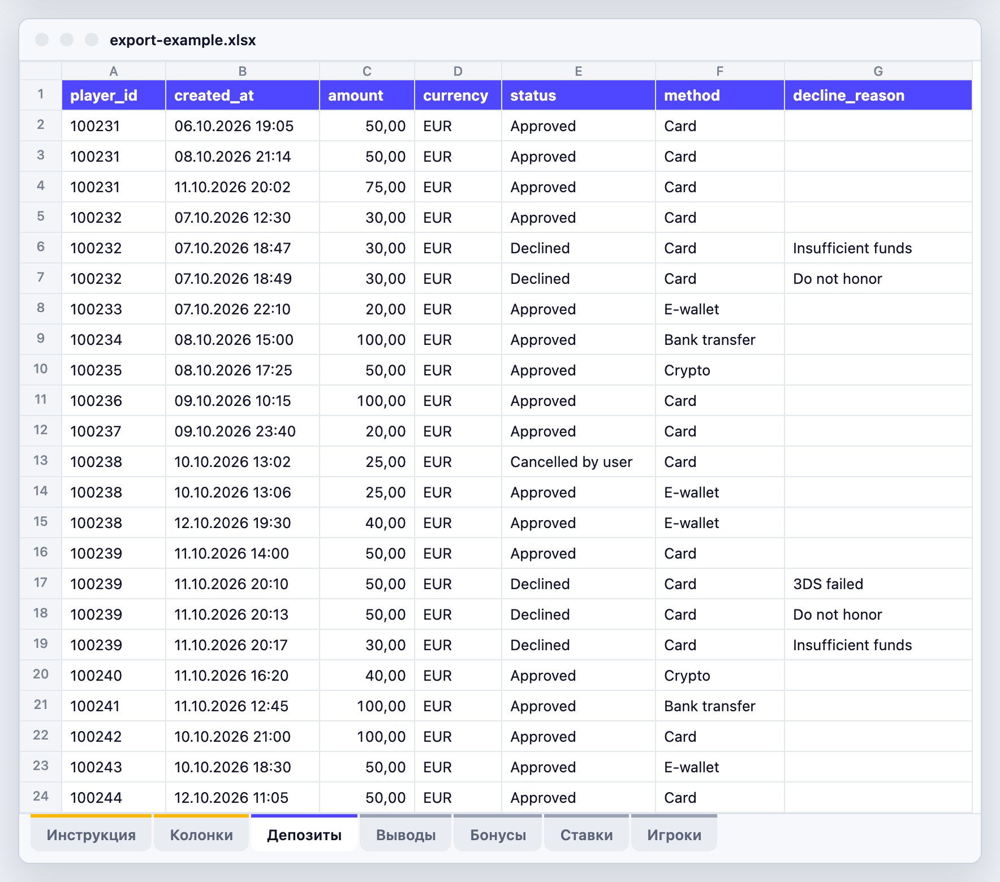

# second deposit: почему FTD не делают второй депозит

Скилл для Claude Code. Берет выгрузки из бэк-офиса казино и за пару минут показывает, на каком сценарии первой сессии теряются игроки, сколько Sum Dep это стоит в месяц и кого из свежих FTD еще можно вернуть.

- **12 причин.** Каждый FTD получает одну: много отказов подряд, второй депозит не прошел, вывод отклонен, запросили документы, отыграл бонус и вывел, долгий вывод, выиграл и вывел, бонус с тяжелым вейджером, сгорел быстро, выиграл и не вывел, деньги на балансе, FTD не с первой попытки. Остальные дают норму.
- **Недобор в деньгах.** Сколько вторых депозитов не хватает до нормы по каждой причине и сколько Sum Dep за 30 дней они бы принесли.
- **24 показателя с определениями.** Второй депозит за 24 часа, 72 часа, 7 и 30 дней, время до него, Sum Dep на FTD, апрув кассы, выводы и отказы по ним, бонусы, первая сессия, динамика по неделям.
- **Где теряете.** Способы оплаты, страны, источники трафика, где второй депозит делают заметно реже, чем игроки с таким же первым депозитом.
- **Список на сегодня.** FTD за последние 72 часа без второго депозита: причина, состояние (вывод в обработке или выплачен, бонус еще отыгрывается), когда писать, что предложить и способ оплаты, который проходит в стране игрока. Файл для импорта в CRM.
- **Правила стран.** Законный срок выплаты (в Бразилии вывод долгий уже через 2 часа), запрещенные в стране способы оплаты не подсказываются, при отказе по законному лимиту депозитов скилл советует объяснить лимит, а не предлагать другой способ. Только официальные источники: [references/geo_rules.md](references/geo_rules.md).


Живой пример: [examples/report-demo.html](examples/report-demo.html) (скачайте репозиторий и откройте файл в браузере). Данные в нем вымышлены.

## Когда смотреть

С первых часов после FTD. Скилл работает в двух режимах:

- **Первый запуск и раз в месяц:** выгрузка за 60-120 дней. Скилл считает норму, недобор и показатели и сохраняет профиль проекта.
- **Каждый день:** выгрузка за последние 7 дней с датой первого депозита у игроков. Скилл строит список на сегодня с прогнозом, способы оплаты и история причин берутся из профиля.

Внутри:

- **Список на сегодня: свежие FTD за последние 72 часа.** Сигнал виден рано: отказ в кассе сразу, бонус с тяжелым вейджером в момент FTD, "сгорел быстро" в первую сессию, вывод в момент запроса, деньги на балансе через сутки. Игрок остается в списке первые 3 дня, пока не сделал второй депозит. Запускайте каждый день: расчет занимает пару минут.
- **Расчет потерь: FTD старше 7 дней.** Вернулся игрок или нет, видно только через 7 дней, поэтому норму и стоимость каждого сценария скилл считает по истории.

Чтобы реагировать без ручного запуска, те же сигналы ставятся триггерами в CRM: [references/scenarios.md](references/scenarios.md).

**Контрольная группа.** 20% списка (кроме сервисных случаев: отказы в кассе подряд, отклоненный и долгий вывод, документы) не получают сообщений 7 дней. Скилл ведет журнал и, когда у этих игроков пройдет 7 дней, показывает, на сколько чаще возвращаются те, кому писали. Это единственная честная цифра эффекта.

## Учится под ваш проект

- **Есть история:** полный запуск собирает профиль проекта: проценты второго депозита за 24 часа, 72 часа, 7 и 30 дней, норму похожих игроков, возвраты по каждой причине, додепы (сумма второго депозита, депозитов у вернувшегося, Sum Dep), апрув по странам и способам оплаты, время выплат. Ежедневные запуски считают по нему прогноз: сколько игроков из списка вернутся без действий и сколько не хватает до нормы.
- **Истории нет:** чужих цифр скилл не подставляет. Надежного публичного бенчмарка второго депозита нет ни по одной стране: мы искали и не нашли открытых цифр с методикой. Причины, действия и правила стран работают с первого дня. Норма, прогноз и деньги появятся с 8-го дня, когда у первых FTD пройдет 7 дней: как только таких FTD наберется 50, скилл сам перейдет на полный расчет по вашим данным.

## Данные остаются у вас

Считают скрипты на вашем компьютере. Claude видит названия колонок, форматы и итоговые цифры, но не строки с игроками: обзор выгрузок скрывает ID, суммы и текст, списки игроков пишутся в файлы. Сторонние библиотеки и интернет не нужны.

## Что выгрузить

Образец: [examples/export-example.xlsx](examples/export-example.xlsx). В нем лист "Инструкция" (какие данные нужны и где их взять в бэк-офисе), лист "Колонки" (что значит каждая колонка) и пять листов данных на вымышленных игроках. Книгу можно заполнить и загрузить как есть, а можно принести свои выгрузки: CSV или XLSX с любыми названиями колонок.



**Выгрузки делает аналитик?** Дайте ему [examples/export-queries.sql](examples/export-queries.sql): запрос на каждый файл с теми же названиями колонок, что в образце, и минимум одним запросом. Достаточно заменить имена таблиц и колонок на свои.

Минимум: депозиты за 60-120 дней со всеми попытками (успешные, отклоненные, брошенные), с датой, суммой, статусом и способом оплаты. Один запрос с депозитами и выводами и данными игрока в каждой строке дает 7 из 12 причин. Чем больше данных, тем больше сценариев посчитается:

| Файл | Что добавляет |
|---|---|
| Депозиты со статусами | FTD, второй депозит, Sum Dep, апрув кассы, причины "много отказов подряд", "второй депозит не прошел", "FTD не с первой попытки"; с причиной отказа еще отказ по лимиту и блокировка гемблинга в банке |
| Выводы со статусом и временем выплаты | причины "вывод отклонен", "долгий вывод", "выиграл и вывел", "отыграл бонус и вывел" |
| Бонусы с вейджером и итогом | причина "бонус с тяжелым вейджером" и действие по статусу бонуса |
| Ставки по дням или сессиям | причины "сгорел быстро", "выиграл и не вывел", "деньги на балансе" |
| Игроки | точное определение FTD, страны (и правила стран), источники, дата запроса документов, исключение самоисключенных и игроков с лимитами |

Claude сам сопоставит колонки со схемой и спросит только то, что нельзя понять из файла. До расчета скилл проверит готовность: скажет, сколько причин из 12 посчитается с вашими файлами и что добавить для остальных. Подробно: [references/data.md](references/data.md).

**Данные в Google Таблицах.** Файл, Скачать, Microsoft Excel (.xlsx): все листы попадут в одну книгу, скилл прочитает ее как есть. По ссылке скилл таблицы не читает: ссылка, открытая без входа в аккаунт, видна любому, у кого она есть, а в таблице данные игроков. Образец тоже можно открыть в Google Таблицах, заполнить и скачать обратно в XLSX.

## Каждый день без ручной работы

1. **Одна папка** для выгрузок, например `~/second-deposit-data`. На Mac не на Рабочем столе и не в Документах или Загрузках: туда планировщик без отдельного разрешения не пустит.
2. **Выгрузки с датой в имени:** `deposits_2026-10-17.csv`, `players_2026-10-17.csv`. Скилл берет самую свежую. Раз в месяц положите туда же выгрузку за 60-120 дней: она станет самой свежей, и скилл пересчитает норму и профиль.
3. **Расписание.** Попросите Claude: "поставь ежедневный запуск second-deposit в 9:00". Он покажет команду и добавит задачу в планировщик системы с вашего согласия. Дальше скрипт работает без Claude: ему нужен только python3.
4. **Утром** результат лежит в `second-deposit/lists/<дата>/`: `actions.csv` (сколько игроков на каждое действие и что делать), файл на каждое действие для загрузки в CRM как сегмент, `rescue_list.xlsx` для чтения в Excel, копия отчета.

## Установка

Нужен Claude Code (в терминале, в десктопном приложении или в расширении для редактора) и `python3`.

### Одна команда

```bash
git clone https://github.com/igamingsychov/second-deposit-igaming.git ~/.claude/skills/second-deposit
```

### Пусть Claude установит сам

Откройте Claude Code и вставьте:

```text
Установи скилл second-deposit из https://github.com/igamingsychov/second-deposit-igaming : склонируй репозиторий в ~/.claude/skills/second-deposit (если папка уже есть, спроси меня), проверь, что есть python3, и скажи, что мне написать для проверки.
```

### Проверка

Откройте новую сессию Claude Code и напишите:

```text
покажи демо скилла second-deposit
```

Claude создаст вымышленную книгу в формате образца и соберет по ней отчет.

Обновить: `git -C ~/.claude/skills/second-deposit pull`. Удалить: `rm -rf ~/.claude/skills/second-deposit`.

## Как пользоваться

- `разбери второй депозит по выгрузкам в ~/Downloads/exports`
- `почему FTD не возвращаются? файлы в папке data`
- `/second-deposit ~/Desktop/payments.xlsx`
- `собери список FTD на сегодня по свежей выгрузке`

На выходе папка `second-deposit` рядом с выгрузками: `report.html` (отчет), `rescue_list.csv` (список для CRM), `summary.json` (итоги), `scenarios.csv` и `segments.csv` (таблицы), `excluded_rg.csv` (кого исключили по ответственной игре) и папка `lists/<дата>/` со списком по действиям. Отчет бывает на русском, украинском и английском: Claude выберет язык вашего вопроса.

**Список для CRM.** У каждого игрока коды причины и действия (`reason_code`, `action_code`), приоритет (1 сейчас, 2 в течение суток, 3 по цепочке или через 1-3 дня), время отправки `send_after_utc` и момент среза `snapshot_utc`, плюс тексты: состояние, что сделать, способ оплаты, правила страны. Файл на каждое действие загружается в CRM как готовый сегмент. Список снимается на момент последней попытки депозита в выгрузке: в CRM поставьте условие "нет депозита после `snapshot_utc`".

## Как считает

- **STD**: доля FTD со вторым депозитом за 7 дней.
- **Норма**: STD похожих игроков без проблемных сигналов: тот же размер FTD, источник и страна.
- **Недобор**: сколько вторых депозитов не хватает до нормы. В деньгах вилка: минимум только сами вторые депозиты, максимум Sum Dep вернувшегося игрока за 30 дней (выбросы обрезаны). Это верхняя граница: столько стоит разрыв.
- **Срезы**: только разрывы больше случайных.
- **Действия по состоянию**: вывод в обработке и выплаченный вывод, активный и проигранный бонус, отказ банка и отказ по лимиту депозитов получают разные рекомендации.
- **Правила стран**: порог долгого вывода по законному сроку страны, если он короче 24 часов; запрещенные в стране способы оплаты не подсказываются; законные лимиты депозитов меняют действие. Справочник с источниками: [references/geo_rules.md](references/geo_rules.md).
- **Ответственная игра**: самоисключенные, игроки с лимитами и с блокировкой гемблинга в банке не входят ни в расчет, ни в список.

Сценарий показывает, где теряются игроки, но не доказывает причину. Причину проверяет тест: действие для половины сценария, вторая половина контрольная. Определения, пороги и триггеры для CRM: [references/scenarios.md](references/scenarios.md).

Окно второго депозита, горизонт Sum Dep, порог тяжелого вейджера и другие параметры меняются по просьбе: `python3 scripts/sd_analyze.py --help`.

## Если что-то не работает

| Симптом | Что делать |
|---|---|
| Статусы без сопоставления | Скрипт перечислит их: скажите Claude, что значит каждый статус, или пусть спросит |
| Валюты без курса | Дайте курс к валюте отчета или выгрузите суммы в одной валюте |
| Даты не разобрались | Проверьте порядок дня и месяца (05.03 это 5 марта или 3 мая) |
| Данные в Google Таблицах | Файл, Скачать, Microsoft Excel (.xlsx) и положите файл в папку |
| Оговорка про часовые пояса | В одних файлах время с поясом, в других без: скажите Claude, в каком поясе пишет касса |
| Мало FTD для анализа | Выгрузите период длиннее: нужно от 50 FTD старше 7 дней, лучше от 300 |
| Сценарий "нет данных" | Добавьте файл, который нужен этому сценарию (таблица выше) |
| `python3: command not found` | macOS: `xcode-select --install` или `brew install python`. Windows: python.org |
| Расписание не срабатывает на Mac | Папка выгрузок на Рабочем столе, в Документах или Загрузках: перенесите ее в домашнюю папку, например `~/second-deposit-data` |
| Скилл взял не тот файл | С `"latest": true` берется самый свежий по времени изменения: не копируйте старые выгрузки в папку поверх новых |

## Автор и лицензия

Автор: Yevhen Sychov, [sychov-igaming.com](https://sychov-igaming.com). Лицензия MIT, см. [LICENSE](LICENSE).

Новые инструменты для ретеншна и CRM: [Telegram-канал Sychov iGaming](https://t.me/+yEnc3sPR_pA0Mzcy).

---

## In English

Export template: [examples/export-example.xlsx](examples/export-example.xlsx) (sheet names and instructions in Russian; column names are plain English). A Claude Code skill that reads your casino back-office exports and shows why first-time depositors do not make a second deposit: 12 reasons (from failed top-ups and slow withdrawals to heavy wagering bonuses and burning out fast) plus everyone else as the norm, missed second deposits and Sum Dep per month for each, 24 metrics with definitions, segments with a real drop, and today's list of recent FTDs to win back with an action for each. Country rules from official sources change the actions: legal payout deadlines, payment methods banned in the country, legal deposit limits. No market benchmarks: without history the skill says so and switches to your own data from day 8. Scripts run on your machine with plain `python3`; Claude only sees column names and totals, never player rows.

```bash
git clone https://github.com/igamingsychov/second-deposit-igaming.git ~/.claude/skills/second-deposit
```

Then ask Claude Code: `show the second-deposit skill demo`, or `why don't our FTDs come back? exports are in ~/Downloads/exports`. Your analyst can use [examples/export-queries.sql](examples/export-queries.sql) to pull the files. Before the run the skill tells you how many of the 12 reasons your files cover. Daily runs can be scheduled without Claude: drop dated exports into one folder, the newest file is picked up, and every morning `second-deposit/lists/<date>/` holds one CSV per action (reason and action codes, priority, send time in UTC) ready to upload to your CRM as a segment. Reports are available in English, Ukrainian and Russian. MIT licence, author Yevhen Sychov.
