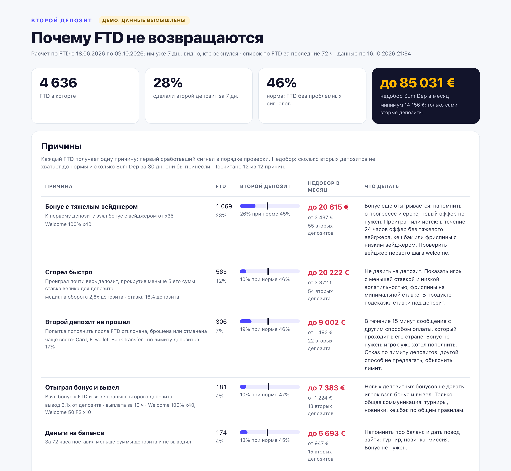

# second deposit: why first-time depositors do not come back

[Русская версия](README.ru.md) | [Skill page](https://sychov-igaming.com/en/skills/second-deposit/)

A Claude Code skill that reads your back-office exports (deposits with all attempts, and if you have them, withdrawals, bonuses, bets and players) and shows why first-time depositors (FTD) do not make a second deposit. Each FTD gets one of 12 reasons, from failed top-ups and slow withdrawals to heavy wagering bonuses and burning out fast. For each reason the skill counts how many second deposits are missing compared with the norm of similar players and how much Sum Dep that is per month, calculates 24 metrics with definitions, finds payment methods, countries and traffic sources where the second deposit is clearly rarer than for players with a similar first deposit, and builds today's list of recent FTDs to win back, with an action for each player's state and country. The calculation is done by Python scripts on your machine; Claude sees column names, formats and totals, never player rows.

## Who it is for

Casino and betting teams:

- **CRM and retention.** A daily list of recent FTDs without a second deposit, one file per action to load into your CRM as a segment, and triggers for the same signals.
- **Product and payments.** Where the first session, the cashier and withdrawals lose players, and what that costs per month.
- **Analysts** who prepare the exports: a SQL file with one query per export file.

## What you get



Live example: [examples/report-demo.html](examples/report-demo.html) (download the repository and open the file in a browser). The example is in Russian and its data is fictional.

- **12 reasons.** Many failures in a row, second deposit failed, withdrawal rejected, documents requested, wagered a bonus and withdrew, slow withdrawal, won and withdrew, heavy wagering bonus, burned out fast, won and kept the balance, money left on balance, FTD not on the first try. Everyone else forms the norm.
- **Missing money.** How many second deposits each reason is short of the norm and how much Sum Dep over 30 days they would bring, as a range.
- **24 metrics with definitions.** Second deposit within 24 hours, 72 hours, 7 and 30 days, time to it, Sum Dep per FTD, cashier approval rate, withdrawals and their rejections, bonuses, first session, weekly trend.
- **Segments.** Payment methods, countries and traffic sources where the gap is larger than chance.
- **Today's list.** FTDs from the last 72 hours without a second deposit: reason, state (withdrawal pending or paid, bonus still being wagered), when to contact, what to offer, and a payment method that works in the player's country.
- **Country rules.** Legal payout deadlines (in Brazil a withdrawal counts as slow after 2 hours), payment methods banned in the country are never suggested, and a decline caused by a legal deposit limit gets "explain the limit" instead of another payment method. Official sources only: [references/geo_rules.md](references/geo_rules.md).

The results go to a `second-deposit` folder next to your exports: `report.html` (the report in English, Ukrainian or Russian, in the language of your question), `rescue_list.csv` (the list for your CRM), `summary.json` (totals), `scenarios.csv` and `segments.csv` (tables), `excluded_rg.csv` (players excluded for responsible gaming) and `lists/<date>/` with `actions.csv`, one file per action and `rescue_list.xlsx`.

Each player in the list has reason and action codes (`reason_code`, `action_code`), a priority (1 now, 2 within a day, 3 in a chain or in 1-3 days), a send time `send_after_utc` and the snapshot time `snapshot_utc`. In your CRM, add the condition "no deposit after `snapshot_utc`".

### Two modes

- **Full run** (first time, then once a month): an export for 60-120 days. Reasons, missing second deposits and Sum Dep against the norm, metrics, segments and the list. Saves a project profile.
- **Daily list**: an export for the last 7 days, with the first deposit date for each player. Today's list with a forecast based on the profile.

**Control group.** 20% of the list (except service cases: failures in a row, rejected and slow withdrawals, documents) get no messages for 7 days. The skill keeps a log and shows how much more often contacted players come back.

## Requirements

- Claude Code (in the terminal, the desktop app or an editor extension).
- `python3` 3.9 or newer. No third-party libraries and no internet access are needed.
- Exports as CSV or XLSX with any column names. The minimum is deposits for 60-120 days with all attempts (successful, declined, abandoned), with date, amount, status and payment method. One query with deposits, withdrawals and player data in each row covers 7 of the 12 reasons. More files cover more reasons:

| File | What it adds |
|---|---|
| Deposits with statuses | FTD, second deposit, Sum Dep, cashier approval, "many failures in a row", "second deposit failed", "FTD not on the first try"; with a decline reason, also declines by deposit limit and gambling blocks at the bank |
| Withdrawals with status and payout time | "withdrawal rejected", "slow withdrawal", "won and withdrew", "wagered a bonus and withdrew" |
| Bonuses with wagering and outcome | "heavy wagering bonus" and the action by bonus status |
| Bets by day or session | "burned out fast", "won and kept the balance", "money left on balance" |
| Players | exact FTD definition, countries (and country rules), traffic sources, document request date, exclusion of self-excluded players and players with limits |

Template: [examples/export-example.xlsx](examples/export-example.xlsx) (sheet names and instructions in Russian, column names in English). For analysts: [examples/export-queries.sql](examples/export-queries.sql), one query per file with the same column names. Before the calculation the skill tells you how many of the 12 reasons your files cover and what to add for the rest. Details: [references/data.md](references/data.md).

## Installation

### Option 1. git clone

```bash
git clone https://github.com/igamingsychov/second-deposit-igaming.git ~/.claude/skills/second-deposit
```

### Option 2. npx skills

```bash
npx skills add igamingsychov/second-deposit-igaming
```

This uses the open skills CLI (needs Node.js). Add `-g -a claude-code` to install the skill for Claude Code in all projects.

### Option 3. Ask Claude Code to install it

Open Claude Code and paste:

```text
Install the second-deposit skill from https://github.com/igamingsychov/second-deposit-igaming : clone the repository into ~/.claude/skills/second-deposit (if the folder already exists, ask me), check that python3 is available, and tell me what to type to test it.
```

### Check

Open a new Claude Code session and type:

```text
show the second-deposit skill demo
```

Claude creates a fictional workbook in the template format and builds a report from it.

Update: `git -C ~/.claude/skills/second-deposit pull`. Remove: `rm -rf ~/.claude/skills/second-deposit`.

## Example requests

- `analyze the second deposit from the exports in ~/Downloads/exports`
- `why don't our FTDs come back? the files are in the data folder`
- `/second-deposit ~/Desktop/payments.xlsx`
- `build today's FTD list from the fresh export`
- `set up a daily second-deposit run at 9:00`

The daily run works without Claude: with your consent, Claude adds a task to the system scheduler (cron on macOS and Linux, schtasks on Windows), and the script needs only `python3`. Put exports with the date in the file name into one folder, for example `deposits_2026-10-17.csv`: the newest file is picked up. Every morning `second-deposit/lists/<date>/` holds the files for your CRM.

## Data stays on your machine

The scripts run locally. Claude sees column names, formats and totals, but not player rows: the export overview hides IDs, amounts and free text, and player lists are written to files. The skill sends nothing anywhere and does not open spreadsheets by link.

## Limitations

- No market benchmarks. There is no reliable public benchmark for the second deposit, so the skill never uses outside numbers. Reasons, actions and country rules work from day one; the norm, forecast and money appear from day 8, once 50 FTDs are older than 7 days. For a full run, export a period with at least 50 FTDs older than 7 days, better 300.
- A reason shows where players are lost, it does not prove the cause. The cause is tested with the control group.
- The missing Sum Dep is an upper bound: the range goes from the second deposits alone to the 30-day Sum Dep of a returning player (outliers trimmed).
- Which reasons are counted depends on the files you provide.
- Online spreadsheets are not read by link: download the workbook as XLSX and put it in the folder.
- Country rules cover 11 countries, as of 18.10.2026. Laws change: check the source before compliance decisions.
- Self-excluded players, players with limits and players with a gambling block at their bank are left out of the calculation and the list. If your exports have no such flags, exclude these players on the CRM side.
- On macOS the scheduler cannot read the Desktop, Documents or Downloads folders without a separate permission: keep the export folder elsewhere, for example `~/second-deposit-data`.
- The skill instructions, references and the template's sheet names are in Russian.

## Links

- Skill page: [sychov-igaming.com/en/skills/second-deposit](https://sychov-igaming.com/en/skills/second-deposit/)
- Russian version of this README: [README.ru.md](README.ru.md)

## License

MIT, see [LICENSE](LICENSE).

## Author

[Yevhen Sychov](https://sychov-igaming.com)

21+. Material for gambling industry professionals, not gambling advertising.
